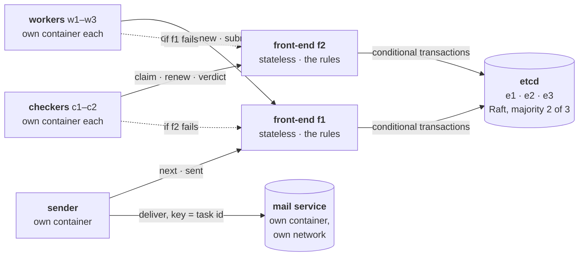

# Stage 9 — Replicated Ledger

Stage 8 ended with a ledger that is **durable but not available**: one process on one host.
Its rules survive a crash, but while it is down nothing moves, and if its disk is lost
everything is lost.

This stage replicates it. The exit criterion: **the coordination plane keeps every Stage 8
guarantee through the crash or freeze of any one replica of the store and of any front-end**
(no task assigned twice, no token issued twice, no lost intent, every email exactly once),
and **every replicated component carries a written justification** of its consistency
mechanism.

The design was decided first, question by question (see *Design* below), before any code.

## At a glance



The participants are Stage 8's, unchanged in behaviour; each now knows both front-ends and
moves to the other when one does not answer. The front-ends hold no state: every task lives
in **etcd**, a key-value store replicated by Raft on three members, which acknowledges a
write only once a majority has it. **No participant has a route to etcd**, and only the
sender reaches the mail service.

## Design: the decisions, in the order they were taken

1. **What is replicated, and how** (classification of every shared object):

   | State | Mechanism | Why |
   |---|---|---|
   | tasks, transitions, epochs, intents, the record of claim requests | total order through consensus (Raft) | exclusive ownership needs agreement *before* answering |
   | lease timers, liveness of participants | soft state at the store's leader | affects only liveness; rebuilt after a failover |
   | drafts | the hash in the record; the text in the record too, because it is small | immutable and content-addressed: nothing to agree on beyond the hash |
   | the mail service's record of idempotency keys | not ours | the receiver's own ground truth; the end-to-end guarantee depends on it |
   | anything mergeable | none needed: **no CRDT** | a claim is mutual exclusion; two replicas accepting claims independently cannot be merged into one owner |

2. **Epochs under replication.** A token is handed out only for a **committed** claim:
   Stage 8's "save before reply" becomes "**commit on a majority before reply**". A deposed
   or cut-off leader cannot commit, so it cannot hand out a token. The epoch needs no Raft
   term: committed entries are never lost or overwritten, so epochs only grow.
3. **Leases across a failover.** Deadlines are not replicated (each machine's clock differs,
   and replaying the log must be deterministic). Time is measured in one place; a lapse is
   **recorded** as a committed change; when the leader changes, every lease restarts in full
   (Stage 8's rule for a restart). A late expiry can never affect a newer holder, because the
   change that reopens a task is conditional on its epoch.
4. **Build or integrate.** Integrate a production Raft store (etcd 3.7), rather than writing
   Raft again: the subject of this stage is putting the ledger's rules correctly on top of
   replication.
5. **Rules as conditional transactions.** Each request becomes: read the task, apply the rule,
   write the result **only if the task is unchanged since the read** (compare-and-swap on its
   modification revision). A claim also writes, in the same transaction, a record of its
   request id, so that a retried claim is recognised by any front-end, and the hold key.
6. **Where task leases live.** In etcd: a claim attaches a hold key to an etcd lease; renewals
   are keep-alives; etcd deletes the hold when the lease runs out; the front-ends watch the
   hold keys and reopen the task by a conditional write (a periodic sweep covers any missed
   event). With several front-ends, timers kept in a front-end's memory would expire a task
   renewed through another one.
7. **The failure experiments**, below.

Why a front-end at all: the store only knows keys and values. Workers are untrusted, so they
must not hold credentials to write keys; the front-ends hold them, and turn each *request* into
the one write the rules allow. They are stateless, so any number can run and any one can die;
they are trusted, which is this stage's main assumption (see the last section).

The theory, with proofs: [chapter 9 of the theory companion](../docs/theory/09-replication.md).

## Files

| File | Role |
|---|---|
| `etcd.py` | A minimal client for etcd's v3 API over its HTTP/JSON gateway, standard library only: reads, conditional transactions, leases, watches; moves to another member when one cannot serve. |
| `ledger.py` | The ledger's rules as pure functions: the task as read in, the task as it must be written out (or STALE / illegal / a recognised repeat). Stage 8's lifecycle, unchanged; no state, no I/O. |
| `frontend.py` | A front-end: each request becomes read → rule → conditional write; claims, renewals as keep-alives, reports, the SENDING intent, expiry from watched lease deletions and a sweep. Fault injection: crash after a commit, before the reply; blind writes (the counterfactual). |
| `test_ledger.py` | 20 offline tests against an in-memory stand-in for etcd that can lose a reply after committing and let another front-end commit between a read and a write. Each load-bearing line was removed once to check that some test fails. |
| `wire.py` | Stage 8's signed messages; the client now knows several front-ends and moves on when one fails or cannot decide (503). |
| `service.py`, `mail_service.py`, `agent.py`, `sender.py` | Stage 8's, with the participants pointed at both front-ends. |
| `lab.py` | Starts three etcd members and two front-ends as host processes, and the participants as processes or in containers; real failures: SIGKILL and SIGSTOP/SIGCONT on members, front-ends, workers and the sender. |
| `experiments.py` | The eight experiments, each against the outcome the design predicts. |
| `test_lab.py` | End to end on a real cluster, with and without a member crash (~12 s). |

## Experiments

Each run starts a fresh system: three etcd members, two front-ends, 3 workers, 2 checkers, a
sender, the mail service, 8 tasks (one rejected draft per four tasks, the last address
invalid). The invariant checked after every experiment: **every SENT task delivered exactly
once, no FAILED task delivered** (the mail service's own record), and **no token ever given
to two holders** (every (task, token) any participant was told it holds names one participant).

| # | Failure injected | Expected | Observed (processes) |
|---|---|---|---|
| 1 | the etcd leader killed mid-run | a new leader in seconds; nothing committed lost; no task assigned twice | new leader after 1.6 s; 17 grants, none shared; all sent once |
| 2 | both followers frozen for 6 s (the leader alone, without a majority) | no token issued; nothing decided (503); resumes on thaw | a claim during the freeze got no decision; all work done 3.7 s after the thaw |
| 3 | a front-end exits after committing a claim, before replying | the retry (same request id) through the other front-end gets the same task and token | claim answered again from the record; the task's first grant is that token |
| 4 | six simultaneous claims for three tasks, through both front-ends | each task granted once; losing conditions re-read | three grants, distinct tasks; 12 failed conditions re-read |
| 5 | a worker frozen until its lease runs out, then thawed | etcd expires the lease, the task is reopened; on thaw the worker is fenced | fenced (STALE); the task done once by another |
| 6 | a worker killed while holding a task, then the etcd leader killed | the task reopened after the lease despite the leader change | reopened (1 expiry), regranted with token 2, sent once |
| 7 | the etcd leader killed while a task is SENDING (mail reply delayed) | the intent survives; the email goes out once | the task ended SENT; one delivery |
| 8 | the race of 4, with **blind writes** (no condition) | (counterfactual) | **all six claimers told they hold T1 with token 1** |

On processes: three full rounds, every mechanism exercised (24 of 24), the invariant held in
every experiment but the counterfactual (21 of 21).

### In containers on the lab host

The same eight with every worker, checker, the sender and the mail service in its own
container on the Mac mini (Apple `container`, 256 MB and one CPU each); the three etcd members
and both front-ends are host processes. Jobs and leases are stretched twice (lease 6 s).

| # | Result | Time |
|---|---|---|
| 1 | leader e1 killed; e3 led after 1.3 s; 17 grants, none shared | 14 s |
| 2 | followers of e1 frozen 6 s; no decision during the freeze; done 4.4 s after the thaw | 20 s |
| 3 | f1 exited after committing w1's claim of T1; the retry through f2 was answered from the record | 16 s |
| 4 | three grants for three tasks; 12 failed conditions re-read | 5 s |
| 5 | w1 frozen holding T7; fenced on thaw | 18 s |
| 6 | w2 killed holding T5, leader e3 killed; T5 reopened and regranted to w3 (token 2) | 20 s |
| 7 | leader e2 killed while T1 was SENDING; T1 sent once | 15 s |
| 8 | blind writes: all six claimers hold T1 with token 1 | 5 s |

The isolation was checked from inside the containers: `w1` reaches the front-end; `w1` and
`c1` have **no route** to the etcd members.

The counterfactual is the stage in one line: replication makes the record survive; only
the condition on every write keeps two front-ends from giving the same token to two holders.

## Running

```bash
python -m unittest test_ledger                   # rules and front-end, offline, < 1 s
python -m unittest test_lab                      # end to end on real etcd, ~12 s
python experiments.py                            # all eight on processes, ~1 min
python experiments.py --backend container        # on the lab host: participants in containers
```

Needs etcd on the host (`brew install etcd`; the lab looks for `/opt/homebrew/opt/etcd/bin/etcd`,
or `ETCD_BIN`). The container backend reuses Stage 8's setup (Apple `container`, the official
`python:3.12-slim` image, code and pydantic mounted read-only).

## What this stage does not establish

- **Trusted coordination.** The front-ends and the etcd members are assumed to fail only by
  crashing. A front-end holds the store's credentials: a malicious one could refuse requests
  (censorship) or write a transition the rules forbid, and etcd would accept it. Tolerating
  that is Stage 10's question (quorum certificates, or making every change carry the signed
  request that justifies it).
- **One machine.** The three members are processes on the lab host: a crashed member is
  tolerated, a power cut is not. Members on independent machines are Stage 13.
- **Partitions by freezing.** A frozen member cannot talk; a member that keeps running but
  cannot reach the others is a different, asymmetric failure. etcd handles both (the leader
  steps down without a majority), but true network partitions need network-level fault
  injection (Stage 12).
- **Honest participants and a deduplicating receiver.** As in Stage 8.
- **Lease timing.** etcd measures leases approximately, and renews them all when its leader
  changes. Safety does not depend on it (fencing compares epochs); only how soon a dead
  holder's task moves does.
