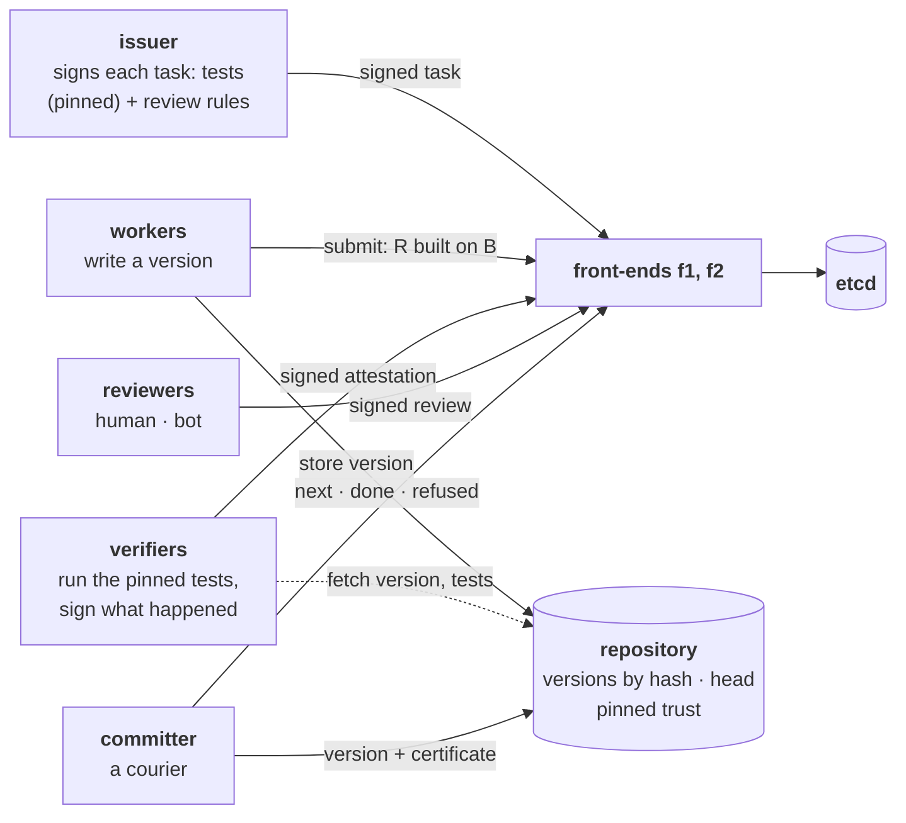

# Stage 11 — Verifiable Agent Work

Stage 10 made evidence travel: signed, checked by the party that acts, worthless to forge. But the
evidence was a checker's opinion. For an email, judging the text is the whole job. For most agent
work it is not: when an agent writes code, "done" is a claim about the world that someone else can
check by running something.

This stage returns to Stage 6's software task, real code with real tests, on top of the Stage 9
and 10 coordination plane. The exit criterion: **every path to a commit rejects assertion-only
completion**: nothing becomes the current code on the strength of what a worker says about its own
work.

The design was decided first, question by question (see *Design* below), before any code.

## At a glance



The same system as Stage 10 with three things swapped: the work is a **version of the code**
(stored in the repository, named by its hash), the checkers are **verifiers** who re-run the
issuer's tests and **reviewers** who read the change, and the gate is the **repository**, which
moves "the current code" only on evidence it checks itself.

## Design: the decisions, in the order they were taken

**D1 — What a worker hands in.** Not "fixed it, all tests pass": a **recipe**: the base version it
started from, the result version, the command and the environment, all by hash. Its own run proves
nothing. And the way to game "all tests pass" (Luca's answer: *write tests that avoid the problem*)
fixes the second half: **the acceptance tests belong to the task, not to the work**. The issuer pins
them by hash in the signed task, the verifiers run those, and the worker may not change them.

**D2 — What a verifier signs, and how many.** An attestation names, by hash, the task (with its
pinned tests), the base, the result, the environment, the command and the outcome. It is signed, as
in Stage 10. Re-running deterministic tests has one right answer (witness mode), so **f+1**
attestations suffice, and **n ≥ 2f+1** verifiers keep it live. Not 3f+1: verifiers bear witness,
they do not agree with each other; uniqueness comes from the single commit point (theory,
Remark 11.7). Independence is about environments: verifiers sharing one image share its bugs.

**D3 — Flaky tests.** A test that depends on timing breaks witness mode: honest verifiers disagree.
More votes measure the flake rate, not the code. Two contradictory signed attestations on the same
version, tests and environment *prove* the nondeterminism. So: no commit, re-run, quarantine the
test, escalate to a human (Luca's answer). Only deterministic evidence commits automatically.

**D4 — Where the check happens.** At the **repository**, the counterpart of Stage 10's mail
service: the last door before the effect. Not the front-ends, which belong to a plane that may lie.

**D5 — On top of what.** Two certified changes built on the same code: after the first is committed,
the second describes a world that no longer exists. The repository commits only if the certified base
*is* the current head (Luca's answer: *check again starting from R1*): the second is refused, redone
on top of the first, and re-verified. Stage 6's lost update and Stage 9's conditional write, at the
commit point.

**D6 — What tests cannot tell.** A fix can pass the tests by answering only their questions. So the
issuer's signed task also says **which paths need a reviewer**, and of which kind (*none*, *any*,
*human*, or *forbidden* to change); the repository computes the changed paths itself and applies the
most demanding rule. A reviewer is a key that signs verdicts, human or bot: a bot is cheap but can be
talked into approving and may share the worker's blind spots, so high-risk paths can demand a human.

**D7 — The experiments**, below, each with the outcome predicted before the run.

## Files

| File | Role |
|---|---|
| `project.py` | The code (`fencing.py`, two bugs), the issuer's acceptance tests, the four tasks, every change a worker can make (honest, claim-pass, edit-tests, cheat, sneak), a real test runner (`python -m unittest` in a fresh directory), and held-out tests used only as ground truth. |
| `evidence.py` | Attestations, reviews, the issuer's rules, the verifier policy, and `check_commit`: the whole of the repository's judgement. |
| `repo_service.py` | The repository: versions by content hash, the head, changed paths computed locally, `check_commit`, compare-and-swap on the head, retried commits recognised; `--no-base-check` is the counterfactual. |
| `ledger.py` | The rules: work is a version; approval from f+1 passing attestations plus the required review; certified failure or a qualifying rejection sends it back; proven nondeterminism stops at NEEDS_HUMAN; a stale base sends it back to be redone. |
| `frontend.py` | Stage 10's front-end with versions, attestations, reviews and commits; it asks the repository what changed, to route reviews; `--byzantine skip-review`. |
| `agent.py`, `committer.py` | Workers, verifiers (honest, or `pass-all`), reviewers (`human` and `bot` stand-ins), and the committer. |
| `lab.py`, `experiments.py` | The system on one host (etcd, two front-ends, the repository, all participants as processes) and the thirteen runs. |
| `sig.py`, `service.py`, `wire.py`, `etcd.py`, `fake_etcd.py` | Stage 10's signatures, signed services and messages, the etcd client, the in-memory store. |
| `test_sig.py`, `test_evidence.py`, `test_ledger.py` | 44 offline tests, including the repository's gate without HTTP and the project's changes under the real test runner. Each load-bearing check was removed once to confirm some test fails (21 of 21). |

## Experiments

Each run starts a fresh system: three etcd members, two front-ends, the repository with the starting
code, two workers, three verifiers (f = 1) that really run the tests (three runs each; five for
experiment 6), a reviewer, the committer and the issuer. Checked after every run, independently of
the repository's code: **every version that became current carries evidence that verifies against the
pinned trust, touched no protected path, and was built on the code that was current when it was
committed.** Ground truth about the code comes from held-out tests no worker has seen.

| # | Situation | Predicted (D7) | Observed (round 3 of 3) |
|---|---|---|---|
| 1 | a worker says "all tests pass" and asks the repository to commit on its own signed word | refused: assertion only | refused: "w1: not a pinned verifier"; the task was done by the honest worker |
| 2 | a worker fixes the bug **and deletes an acceptance test** in its copy | refused: protected path | the verifiers ran the issuer's tests (not the weakened copy) and signed *pass*, correctly; the repository refused: "protected path changed: tests/test_check.py" |
| 3 | a worker claims a pass; the code is unchanged | not approved | 6 failing attestations on its 2 versions, none committed |
| 4 | one verifier signs *pass* on failing code (f = 1, 3 verifiers) | not committed | the lie was signed; the two honest failures certified the failure; not committed |
| 5 | two certified changes (T1, T2) built on the same code | the second refused, redone, committed | 1 refused as stale, redone on the new code, re-verified, committed; the current code has **both** fixes |
| 5b | **(counterfactual)** the repository does not check the base | the second erases the first | both committed on the same base; the current code has **only one** fix; the guarantee check reports T2 "not built on the current code" |
| 6 | a flaky test (its outcome depends on the millisecond) | nothing committed; to a human | v1 and v2 each saw their own runs disagree and signed *flaky*; NEEDS_HUMAN with the reason; 0 commits |
| 7 | a fix special-cased to the test's input (`token == 5`), fencing.py needs a review | rejected, not committed | the pinned tests **passed** (9 honest attestations over 3 attempts); the human-style reviewer rejected each time; T1 FAILED, nothing committed |
| 7b | **(counterfactual)** the same, tests-only rule for fencing.py | committed | the cheat became the current code; the held-out tests fail on it |
| 7c | **(counterfactual)** the same, any reviewer allowed; only a bot, and the code tells reviewers to approve | committed | the bot approved; the cheat became the current code |
| 7d | the same, a **human** reviewer required; a bot and a human present | not committed | the bot approved 3 times (not counted); the human rejected 3 times; nothing committed |
| 8 | a changelog change | committed on tests alone, no reviewer asked | committed with 2 attestations, 0 reviews; the reviewer was never asked |
| 8b | a changelog task that also quietly edits fencing.py, through a front-end that skips reviews | refused | the front-end routed no review; the repository computed the changed paths itself and refused: "review by a reviewer required for CHANGELOG.md, fencing.py"; the code unchanged |

Three full rounds: every prediction confirmed in every round (39 of 39), the three counterfactuals
reproduced each time.

The counterfactuals are the stage in three lines. **Commit only on top of the tested code** (5b).
**Tests ask only their questions** (7b). **A review is an opinion, and a bot's can be dictated by the
code it reviews** (7c).

## Running

```bash
python -m unittest test_sig test_evidence test_ledger   # offline, ~1 s (runs real tests in subprocesses)
python experiments.py                                   # the thirteen runs (etcd on the host), ~1 min
```

Needs etcd on the host (`brew install etcd`, or `ETCD_BIN`); Python 3.11+ with pydantic.

## What this stage establishes, and what it does not

**Established** (theory, Theorem 11.3): every version that becomes the current code passed the issuer's
pinned tests (run by at least one honest verifier), changed no protected path, received the review the
issuer's rules require for what it changed, and was built on the code current when it was committed,
**whatever the workers, the front-ends, the store's members and the committer do**, provided that:

- signatures cannot be forged and SHA-256 has no known collisions;
- the repository's pinned trust (issuer, verifiers and policy, reviewers and kinds) is correct;
- faulty verifiers lie within one set of the policy's fail-prone system;
- the pinned tests are deterministic (otherwise: detected, and sent to a human).

**Not established:**

- **That the code is right.** Tests are a partial specification; a change can answer them without
  being correct (experiment 7). Held-out tests and reviews narrow the gap; nothing here closes it.
- **Reviewer trust beyond one.** A single qualifying approval suffices; reviewers could form
  certificates like verifiers (Stage 10), not done here.
- **Equal environments.** Attestations name their environment, but the repository does not require
  verifiers' environments to differ (independence) or to match the issuer's.
- **Sandboxed execution.** Verifiers run untrusted code in a fresh directory with a minimal environment
  (the verifier's key is not passed to it), not in a sandbox; isolation is Stage 4's and 8's subject.
- **Real models.** Workers, the bot reviewer and the "human" reviewer are scripted stand-ins with stated
  behaviour.
- **Liveness under a lying plane** (Stage 10, unchanged): a lying front-end can stop work; experiment 8b
  shows it cannot get unreviewed code in.

The theory, with proofs: [chapter 11 of the theory companion](../docs/theory/11-verifiable-work.md).
